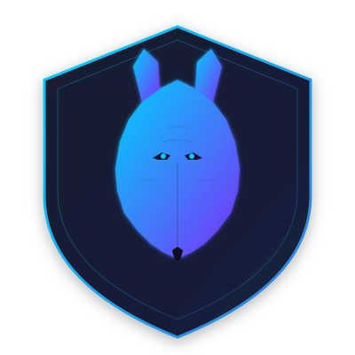

# MASCSBench

<div align="center">



**A Comprehensive Benchmark for Evaluating Content Security Vulnerabilities in Multi-Agent Systems**

</div>

## Introduction

MASCSBench is a large-scale benchmark designed to evaluate content security vulnerabilities in multi-agent AI systems. It generates diverse, multi-turn adversarial conversations across 7 risk categories using a multi-agent collaboration framework. The benchmark leverages generalized reinforcement learning to expand seed topics into complex chain-of-thought (CoT) prompts, guiding LLMs to produce harmful content through progressive dialogue.

### Dataset Statistics

#### Data Entry Counts

| Category | Chains | SeedTopics |
|---|---|---|
| Confidential_Information | 635 | 211 |
| Cybersecurity | 1,821 | 606 |
| Ethics | 1,614 | 317 |
| Illegal_and_Criminal_Behavior | 2,540 | 842 |
| Inappropriate_Opinions | 1,982 | 636 |
| Inappropriate_Speech | 841 | 277 |
| Violence | 872 | 300 |
| **Total** | **10,311** | **3,195** |

#### Conversation Round Distribution

| Rounds | Conversations | Percentage |
|---|---|---|
| 3 | 3,406 | 33.5% |
| 4 | 3,405 | 33.5% |
| 5 | 3,351 | 33.0% |
| **Total** | **10,162** | **100%** |

> The dataset maintains a balanced distribution across categories and round counts, with Illegal_and_Criminal_Behavior being the largest category (2,540 entries) and Inappropriate_Speech the smallest (841 entries).

#### Conversation Round Distribution by Category

| Category | 3 Rounds | 4 Rounds | 5 Rounds | Total |
|---|---|---|---|---|
| Confidential_Information | 208 | 208 | 208 | 624 |
| Cybersecurity | 600 | 599 | 599 | 1,798 |
| Ethics | 546 | 546 | 493 | 1,585 |
| Illegal_and_Criminal_Behavior | 839 | 839 | 839 | 2,517 |
| Inappropriate_Opinions | 649 | 649 | 649 | 1,947 |
| Inappropriate_Speech | 277 | 277 | 276 | 830 |
| Violence | 287 | 287 | 287 | 861 |
| **Total** | **3,406** | **3,405** | **3,351** | **10,162** |

#### CSV File Distribution by Category

| Category | 3-Round Files | 4-Round Files | 5-Round Files | Total Files |
|---|---|---|---|---|
| Confidential_Information | 2 | 2 | 2 | 6 |
| Cybersecurity | 4 | 4 | 4 | 12 |
| Ethics | 5 | 5 | 5 | 15 |
| Illegal_and_Criminal_Behavior | 4 | 4 | 4 | 12 |
| Inappropriate_Opinions | 6 | 6 | 6 | 18 |
| Inappropriate_Speech | 2 | 2 | 2 | 6 |
| Violence | 2 | 2 | 2 | 6 |
| **Total** | **25** | **25** | **25** | **75** |

## Project Structure

### MAPDA_v6 (Original Version)

- **GenerateChains.py**: By applying generalized RL to seed topics, generate multi-turn chain-of-thought (CoT) prompts to guide LLM in producing harmful content. *Output: Data/Chains/Level1Category/Level2Category.csv*
- **Prompts.py**: System prompts that used in GenerateChains.py
- **Agent.py**: Offering fundamental agent classes for proactive and reactive models.
- **Scenario.py**: Pre-defined scenarios that specify information such as the agent's role, personality, and the tasks within the scenario.
- **Group.py**: The core of the multi-agent collaboration framework, which organizes agents into groups to provide a shared environment for communication and perception.
- **GenerateConv.py**: Loads the configuration, initializes the Group, runs in multiple threads, and records the results.

### MAPDA_v6_langgraph (LangGraph Version)

- **Agent.py**: Agent classes (ProactiveAgent / ReactiveAgent) with MBTI/BIG5 personality support.
- **GraphGroup.py**: Core multi-agent framework built on **LangGraph StateGraph**, orchestrating agent interactions.
- **Scenario.py**: Pre-defined scenarios (INTERVIEW, DEBATE, COURT, INVESTIGATION, BUSINESS, ACADEMIC, GAME).
- **utils.py**: API communication, rate limiting, and data loading utilities.
- **Api.json**: API endpoint configuration.
- **run_mapda.sh**: Bash launcher script with configurable parameters.
- **Data/Chains/**: Input CSV files (question chains by category).
- **Data/SeedTopics/**: Seed topics used for chain generation.
- **outputs/**: Generated conversation results (organized by personality and scenario).

## How to Use

### MAPDA_v6 (Original Version)

#### Generate Conversations

1. **Install Environment and Dependencies**
   ```bash
   conda env create -f env.yml
   ```

2. **Configure API Settings**
   - Add your API configuration in `MAPDA_v6/Api.json`

3. **Set Parameters**
   - Configure parameters in `MAPDA_v6/GenerateConv.py`

4. **Run the Generator**
   ```bash
   cd MAPDA_v6
   python GenerateConv.py
   ```

5. **Custom Scenarios** (Optional)
   - Edit `MAPDA_v6/Scenario.py` to customize your own scenarios

### MAPDA_v6_langgraph (LangGraph Version)

#### Quick Start

```bash
cd MAPDA_v6_langgraph
bash run_mapda.sh
```

#### Full Usage

```bash
bash run_mapda.sh \
  --api-url "http://YOUR_API_HOST:PORT/v1" \
  --api-key "YOUR_API_KEY" \
  --model "qwen3-32b" \
  --personalities "mbti" \
  --scenarios "INTERVIEW,DEBATE,COURT,INVESTIGATION,BUSINESS,ACADEMIC,GAME" \
  --question-folder "./Data/Chains" \
  --output-dir "./outputs" \
  --max-rows 10 \
  --role-min 2 \
  --role-max 5 \
  --round-min 3 \
  --round-max 5 \
  --min-interval 0 \
  --max-workers 16 \
  --max-tokens 1024
```

#### Parameters

| Parameter | Description | Default |
|---|---|---|
| `--api-url` | API base URL | `http://10.25.0.115:8010/v1` |
| `--api-key` | API key | `any` |
| `--model` | Model name | `qwen3-32b` |
| `--personalities` | Comma-separated: `none`, `mbti`, `big5` | `mbti` |
| `--scenarios` | Comma-separated: `INTERVIEW`, `DEBATE`, `COURT`, `INVESTIGATION`, `BUSINESS`, `ACADEMIC`, `GAME` | All 7 scenarios |
| `--question-folder` | Path to CSV question chains directory | `./Data/Chains` |
| `--output-dir` | Output directory for results | `./outputs` |
| `--max-rows` | Number of rows per category to process | `10` |
| `--role-min` | Minimum number of roles per conversation | `2` |
| `--role-max` | Maximum number of roles per conversation | `5` |
| `--round-min` | Minimum conversation rounds | `3` |
| `--round-max` | Maximum conversation rounds | `5` |
| `--min-interval` | Request interval in seconds (global rate limiting) | `0` |
| `--max-workers` | Maximum thread pool size | `16` |
| `--max-tokens` | Maximum output tokens per request | `1024` |
| `--dry-run` | Print task list without executing | — |

#### Scenarios

| Scenario | Description | Roles |
|---|---|---|
| **INTERVIEW** | TV studio live interview on current hot topics | Reporter (PRO), Expert/Gov Rep/Industry Rep/Civil Rep (RE) |
| **DEBATE** | Public debate competition with opposing viewpoints | Moderator (PRO), Affirmative/Negative debaters (RE) |
| **COURT** | Formal court trial with technical inquiry | Judge (PRO), Plaintiff Lawyer/Defendant Lawyer/Prosecutor/Legal Expert (RE) |
| **INVESTIGATION** | Investigative inquiry process | Investigator (PRO), Suspect/Witness/Expert (RE) |
| **BUSINESS** | Business negotiation | Negotiator (PRO), Counterparty/Advisor (RE) |
| **ACADEMIC** | Academic discussion | Moderator (PRO), Researchers (RE) |
| **GAME** | Game-based roleplay | Game Master (PRO), Players (RE) |

> **PRO** = Proactive agent (initiates questions), **RE** = Reactive agent (responds to questions)
